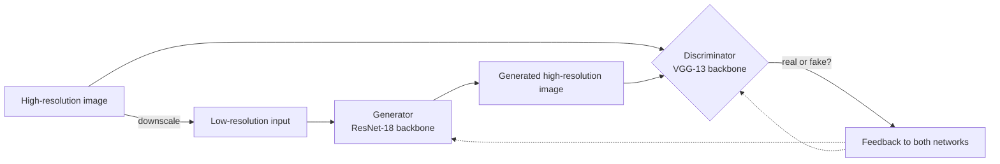

<div align="center">

# 🔍 GAN Super-Resolution

### Turn small, blurry images into sharper, larger ones with deep learning.


**A generative adversarial network that learns to rebuild the detail a low-resolution image has lost.**

[Why it matters](#-why-it-matters) · [How it works](#-how-it-works-in-one-minute) · [Results](#-results) · [Quick start](#-quick-start) · [Technical deep dive](#-technical-deep-dive)

</div>

---

## 🎯 Why it matters

Low-resolution images are everywhere: product photos from suppliers, old archive pictures, compressed profile images, thumbnails, frames from cheap cameras. Simple resizing makes them bigger but also blurrier. People need **more detail, not just more pixels**.

This project trains a neural network to do exactly that. Given a small image, it produces a larger one with sharper edges and more convincing texture, because it has learned what real images look like.

| Without this | With this |
|---|---|
| Classic resizing stretches pixels and blurs edges | A trained generator predicts plausible fine detail |
| One fixed rule for every image | A model that learns from thousands of real images |
| Quality limited by the source file | Usable images from low-quality sources |

**Where this kind of model is useful**
- 🛒 **E-commerce and catalogues:** sharper product images from low-quality supplier files
- 🗂️ **Archives and old photos:** restore detail in small or scanned images
- 👤 **Faces and profile images:** crisper portraits from small thumbnails
- 🎥 **Media pipelines:** upscale frames and thumbnails without re-shooting

---

## ✨ Highlights

- **Adversarial training:** a generator and a discriminator compete, which pushes the output toward realistic images, not just averaged ones
- **Transfer learning:** the generator and discriminator reuse **pre-trained ResNet-18 and VGG-13** networks, so far fewer layers need training
- **Learns from data you already have:** no manual labelling, because every high-resolution image creates its own training pair by being downscaled
- **Works on several datasets:** CelebA faces, CIFAR-10, CIFAR-100 and ImageNet 64x64
- **Easy to monitor:** TensorBoard loss curves and a live low-resolution, real and generated preview while training
- **Simple to run:** one command to train, one to test

---

## 🧠 How it works in one minute



1. Take a real image and shrink it. The small version is the **input**, the original is the **answer**.
2. The **generator** upscales the small image and tries to match the original.
3. The **discriminator** looks at real and generated images and tries to spot the fakes.
4. Each network improves by trying to beat the other. Over many rounds, the generator learns to produce images the discriminator can no longer tell apart from real ones.

---

## 🖼️ Results

> _Add your before and after comparison here. This is the most important part of the page._

| Low-resolution input | Generated by this model | Original |
|:---:|:---:|:---:|
| `` | `` | `` |

Generate the three image sets with `./test` (see below). They are saved to `output/low_res`, `output/high_res_fake` and `output/high_res_real`. Pick your two or three best examples and put them in a `docs/` folder.

---

## 🚀 Quick start

**1. Get the data.** Download the aligned and cropped faces from the [CelebA page](http://mmlab.ie.cuhk.edu.hk/projects/CelebA.html). Unzip the images into a folder inside another folder, so the layout is `folder1/folder2/<images>`, with no other folders inside `folder1`.

**2. Train**

```bash
./train --dataset=folder --dataroot="<folder1_location>" --imageSize=89 --cuda
```

**3. Generate results**

```bash
./test --dataset=folder --dataroot="<folder1_location>" --imageSize=89 --cuda
```

Checkpoints are saved to `checkpoints/`. Generated images are saved to `output/`.

**Requirements:** Python, PyTorch with torchvision, Pillow, matplotlib and `tensorboard_logger`. The code was written for the PyTorch 0.3 era API, so a newer PyTorch needs small updates (`Variable`, `transforms.Scale` and `.data[0]`).

---

## 🔬 Technical deep dive

### Architecture

Based on SRGAN ([Ledig et al., 2017](https://arxiv.org/abs/1609.04802)), with transfer learning added to reduce training cost.

<details>
<summary><b>Generator</b> (<code>resnet_generator</code> in <code>models.py</code>)</summary>

- Built on a pre-trained **ResNet-18**, with its pre-trained layers frozen
- Trainable 9x9 input convolution
- Trainable 3x3 expansion convolutions between the pre-trained residual stages (64 to 128, 256 and 512 channels), and a final projection back to 64 channels
- Global skip connection from the first convolution to the end of the residual stack
- Sub-pixel upsampling (`PixelShuffle`) with PReLU activation
- Trainable 9x9 output convolution that produces the RGB image
</details>

<details>
<summary><b>Discriminator</b> (<code>DiscriminatorPretrained</code> in <code>models.py</code>)</summary>

- Pre-trained **VGG-13 with batch normalisation** as a frozen feature extractor
- Trainable classifier head: fully connected layer (1024 units), LeakyReLU, single output with sigmoid
</details>

<details>
<summary><b>Original SRGAN networks</b></summary>

`models.py` also contains the original SRGAN generator (16 residual blocks, swish activation) and the fully convolutional discriminator from the paper. The final experiments used the transfer learning networks above.
</details>

### Training setup

| Item | Setting |
|---|---|
| Framework | PyTorch |
| Content loss | Mean squared error between generated and real image |
| Adversarial loss | Binary cross-entropy, weighted 1e-3 against the content loss |
| Label handling | Soft, randomised real and fake targets to stabilise the discriminator |
| Optimiser | Adam, learning rate 1e-5 for both networks |
| Batch size | 16 (default) |
| Epochs | 100 (default) |
| Upscaling factor | 2x (default, set with `--upSampling`) |
| Logging | TensorBoard loss curves and a live image preview |

### Command line options

| Option | Meaning | Default |
|---|---|---|
| `--dataset` | `cifar10`, `cifar100`, `folder` or `imagenet64` | `cifar100` |
| `--dataroot` | Path to the data | `./data` |
| `--imageSize` | Low-resolution image size | 15 |
| `--upSampling` | Scale factor | 2 |
| `--batchSize` | Batch size | 16 |
| `--nEpochs` | Number of epochs | 100 |
| `--generatorLR`, `--discriminatorLR` | Learning rates | 0.0001 |
| `--generatorWeights`, `--discriminatorWeights` | Resume from checkpoints | none |
| `--cuda`, `--nGPU` | GPU use | off, 1 |

### Repository layout

| File | Purpose |
|---|---|
| `models.py` | Generator and discriminator networks |
| `train` | Training script |
| `test` | Generates low-resolution, real and generated images from a checkpoint |
| `imgnet64ToFloatTensor.py` | Loader for the ImageNet 64x64 dataset |
| `utils.py` | Live visualisation during training |

---

## 👥 Team

_Add the names of your team members._

## 📌 Status

Academic project from 2017/18 at the Technical University of Munich, built for the Deep Learning for Computer Vision course. Not actively maintained.

## 🙏 Acknowledgements

- [SRGAN paper](https://arxiv.org/abs/1609.04802) by Ledig et al.
- [CelebA dataset](http://mmlab.ie.cuhk.edu.hk/projects/CelebA.html) from the Chinese University of Hong Kong
- Pre-trained ResNet-18 and VGG-13 models from torchvision
